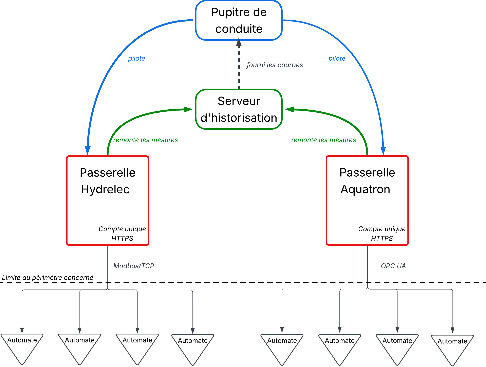
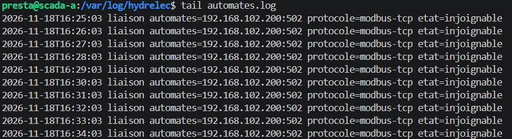
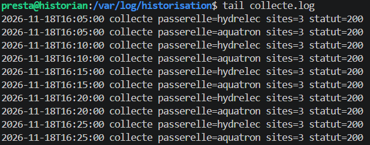
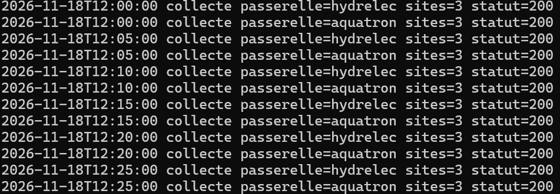
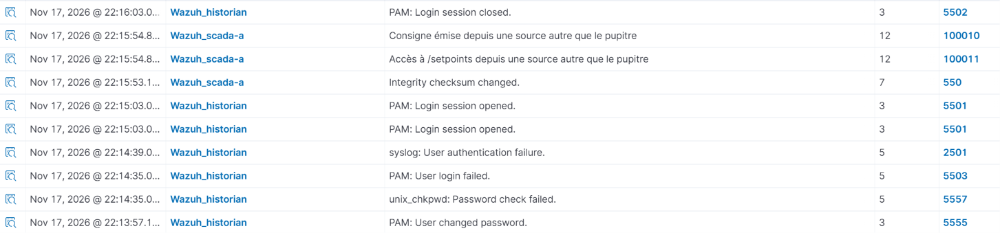
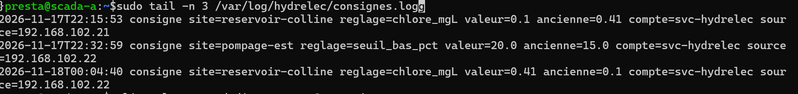

# Rapport final — Groupe 2 — Secteur eau

**Membres du groupe :** Maxime VANNIER - Vu Trung HOANG

**Date de rendu :** 29/11/2026

---

## 1. Architecture _(≤ 1 page)_ · séances 1 et 2

_Le schéma de l'architecture **prévue**, à la seule lecture du dossier client découvert en séance 1._



_Le schéma de l'architecture **réelle**, telle que vous l'avez découverte en
séance 2._


| Écart constaté                      | Explication                                                                                              | Décision (autoriser / refuser / surveiller)     |
| ----------------------------------- | -------------------------------------------------------------------------------------------------------- | ----------------------------------------------- |
| Machines manquantes (Jump et Wazuh) | non évoquées dans le dossier client                                                                       | rajoutées dans la matrice de flux, à surveiller |
| Flux NTP pour horloges synchronisées | non évoqués dans les logiques métiers du client                                                          | autorisés                                       |
| Flux de _historian_ vers Internet   | visible seulement depuis la machine concernée, utilisé pour mettre à jour son horloge en tant que master | à surveiller/refuser si solution autre          |
| Flux métiers bidirectionnels        | ambiguïté dans le dossier client                                                                         | autorisés                                       |

## 2. Matrice de flux et durcissement _(≤ 1 page)_ · séances 2 et 3

| #     | Source                                     | Destination                                 | Port / proto            | Justification                                                                                                | Preuve                                                  |
| ----- | ------------------------------------------ | ------------------------------------------- | ----------------------- | ------------------------------------------------------------------------------------------------------------ | ------------------------------------------------------- |
| 1     | Internet                                   | jump                                        | TCP/22 (exposé en 2202) | Point d'entrée unique d'administration                                                                       | `ss`, incident SSH 06/11                                |
| 2     | jump                                       | scada-a, scada-b, historian, pupitre, wazuh | TCP/22                  | Administration SSH                                                                                           | `ss -tnp`                                               |
| 3     | jump, scada-a, scada-b, historian, pupitre | wazuh                                       | TCP/1514                | Remontée des journaux (agents)                                                                               | `ss -tnp` sur wazuh                                     |
| 4     | jump, scada-a, scada-b, historian, pupitre | wazuh                                       | TCP/1515                | Enrôlement des agents. Ouvert en permanence, limité aux 5 IP des agents                                      | `ss -tulpn` wazuh                                       |
| 5     | Internet (toutes les sources)              | wazuh                                       | TCP/443                 | Dashboard Wazuh (exposé en 4402), protégé par authentification                                               | `ss -tulpn` wazuh, journaux `IN-DROP` (`DPT=443`)       |
| 6     | jump, scada-a, scada-b, pupitre, wazuh     | historian                                   | UDP/123                 | Synchronisation horaire (historian = référence)                                                              | `chronyc clients`, `tcpdump`                            |
| 7     | historian                                  | Internet (toutes adresses, **temporaire**)  | UDP/123                 | Obtention de l'heure de référence (aucune source interne).                                                   | `chronyc sources -n`, `tcpdump -i any -nn udp port 123` |
| 7 bis | historian                                  | 9.9.9.9 (Quad9), 1.1.1.1 (Cloudflare)       | UDP/53 (repli TCP/53)   | **Temporaire** : résolution des noms des serveurs NTP. À supprimer quand les sources seront déclarées par IP | `resolvectl status`, `tcpdump -i any -nn port 53`       |
| 8     | pupitre                                    | historian                                   | TCP/443                 | Courbes (`GET /series`)                                                                                      | `courbes_access.log`                                    |
| 9     | historian                                  | scada-a, scada-b                            | TCP/443                 | Collecte (`GET /registers`, toutes les 5 min)                                                                | `collecte.log`                                          |
| 10    | pupitre                                    | scada-a, scada-b                            | TCP/443                 | `GET /registers`, consignes (`POST /setpoints`)                                                              | `passerelle_access.log`, `consignes.log`                |

_Note sur le flux n°7: configuration temporaire puisqu'il serait judicieux de trouver une solution de mise à jour d'horloge sans passer par internet (par exemple par GPS) mais ce n'est pas possible dans le cadre de ce travail, avec les accès que nous avions. Nous avons donc laissé l'accès aux serveurs distants avec une résolution DNS car les IP de ces derniers varient._

**Durcissement**:

Nous avons édité le fichier /etc/iptables/rules.v4 afin d'appliquer nos politiques de blocage et avons rédigé chaque règle en fonction de la matrice ci-dessus avec une politique par défaut de DROP. Ci-dessous, un exemple des règles pour la machine _historian_:

```
# Règles iptables (IPv4) de cette historian, rechargées au démarrage par netfilter-persistent.

*filter
:INPUT DROP [0:0]
:FORWARD DROP [0:0]
:OUTPUT DROP [0:0]

# --- Base : loopback, paquets invalides, connexions etablies ---
# On accepte les flux provenant de connexions établies, en INPUT et OUTPUT puisque le filtrage
# d'établissement de ces connexions se fait dans les règles suivantes (construite à partir de la matrice de flux)

-A INPUT -i lo -j ACCEPT
-A OUTPUT -o lo -j ACCEPT
-A INPUT -m conntrack --ctstate INVALID -j DROP
-A OUTPUT -m conntrack --ctstate INVALID -j DROP
-A INPUT -m conntrack --ctstate ESTABLISHED,RELATED -j ACCEPT
-A OUTPUT -m conntrack --ctstate ESTABLISHED,RELATED -j ACCEPT

# Flux 2 : administration depuis jump
-A INPUT -p tcp -s 192.168.102.10 --dport 22 -j ACCEPT

# Flux 8 : courbes depuis pupitre
-A INPUT -p tcp -s 192.168.102.22 --dport 443 -j ACCEPT

# Flux 6 : serveur horaire pour jump, scada-a, scada-b, pupitre, wazuh
-A INPUT -p udp -s 192.168.102.10,192.168.102.20,192.168.102.22,192.168.102.24,192.168.102.30 --dport 123 -j ACCEPT

# Flux 9 : collecte vers scada-a et scada-b
-A OUTPUT -p tcp -d 192.168.102.20,192.168.102.24 --dport 443 -j ACCEPT

# Flux 3 et 4 : journaux et enrolement vers wazuh
-A OUTPUT -p tcp -d 192.168.102.30 --dport 1514 -j ACCEPT
-A OUTPUT -p tcp -d 192.168.102.30 --dport 1515 -j ACCEPT

# Flux 7 : NTP vers Internet (TEMPORAIRE : a restreindre aux IP des serveurs NTP)
-A OUTPUT -p udp --dport 123 -m comment --comment "TEMP flux7 NTP Internet" -j ACCEPT

# Flux 7 bis : DNS vers 9.9.9.9 et 1.1.1.1 (TEMPORAIRE : a supprimer apres passage des sources en IP)
-A OUTPUT -p udp -d 9.9.9.9,1.1.1.1 --dport 53 -m comment --comment "TEMP flux7bis DNS" -j ACCEPT
-A OUTPUT -p tcp -d 9.9.9.9,1.1.1.1 --dport 53 -m comment --comment "TEMP flux7bis DNS" -j ACCEPT

# --- Journalisation des refus (avant la politique DROP) ---
-A INPUT -m limit --limit 5/min --limit-burst 10 -j LOG --log-prefix "IN-DROP: "
-A OUTPUT -m limit --limit 5/min --limit-burst 10 -j LOG --log-prefix "OUT-DROP: "
COMMIT
```

Pour tester l'application de ces tables, la priorité était de vérifier que nous avions conservé nos accès SSH aux différentes machines. Ce fut bien le cas, mais nous nous sommes rendu compte après coup que, une fois chez nous, nous ne pouvions plus joindre le dashboard Wazuh. Cela provenait d'une erreur de configuration des iptables de la machine 'wazuh' (cf. Flux n°5) dont nous avions autorisé l'accès depuis internet UNIQUEMENT depuis une IP fixe, qui était celle d'un PC connecté à eduroam (wifi de l'école). Nous avons donc retiré ce filtre précis, et autorisé les connexions distantes uniquement dirigées vers le port 443 où était exposé le dashboard Wazuh. À noter que cela pose un problème de sécurité mineur puisque cette page reste protégée par un identifiant/mot de passe.

Enfin, nous avons regardé les différents logs métiers et logs réseaux (Nginx) des différentes machines pour s'assurer que les seuls flux restants étaient bien respectueux du cahier des charges du client, ce qui fut le cas. Voir les captures d'écran ci-dessous montrant la continuité des flux nécessaires post-iptables:

#### Connexion depuis scada-a vers les automates



#### Connexion pupitre vers passerelle (consultation et réglage)


#### Réception des consignes du pupitre par scada-a


#### Collecte des courbes depuis passerelle vers 'historian'



#### Requête de l'historian vers les passerelles


## 3. Supervision et détection _(≤ 1 page)_ · séances 2 et 3

Un agent Wazuh est installé sur les cinq machines (jump, scada-a, scada-b, historian, pupitre) et le serveur wazuh est lui aussi surveillé. Par défaut, chaque agent remonte le journal système (SSH, sudo, PAM). Nous y avons ajouté les journaux métiers du client, qui répondent à la question « qui fait quoi, depuis quelle machine » :

| Source (machine)    | Journal collecté                                                     | Ce qu'il permet de voir                                                            |
| ------------------- | -------------------------------------------------------------------- | ---------------------------------------------------------------------------------- |
| toutes les machines | journal système (par défaut)                                         | connexions SSH, sessions, `sudo`, changements de mot de passe (incidents 1 et 2)   |
| scada-a, scada-b    | `/var/log/nginx/passerelle_access.log`                               | qui lit (`GET /registers`) et qui écrit (`POST /setpoints`), avec l'adresse source |
| scada-a, scada-b    | `/var/log/hydrelec/consignes.log`, `/var/log/aquatron/consignes.log` | les réglages appliqués : site, valeur, ancienne valeur, compte, source             |
| historian           | `/var/log/historisation/collecte.log`                                | le succès ou l'échec de chaque collecte, toutes les 5 minutes                      |
| historian           | `/var/log/nginx/courbes_access.log`                                  | les accès aux courbes                                                              |
| pupitre             | `/var/log/pupitre/conduite.log`                                      | les consultations, les courbes et les réglages des opérateurs                      |

Nous n'avons pas collecté `automates.log` (liaisons vers les automates injoignables dans le lab).

**Ajustements de collecte.** L'agent de scada-b avait été enrôlé vers sa propre adresse au lieu de celle du serveur (192.168.102.30) : corrigé. Les journaux métiers sont du texte sans décodeur (`No decoder matched` dans `wazuh-logtest`) : les règles qui les lisent s'appuient sur le texte de la ligne. Les journaux nginx sont décodés (`web-accesslog`) et fournissent l'adresse source, l'URL et le code HTTP. La lecture de chaque fichier a été contrôlée par la mention `Analyzing file` dans `/var/ossec/logs/ossec.log` de chaque agent.

**Ce qui est normal chez le client.** Le dossier décrit trois comportements que nos journaux confirment :

- la collecte « tourne toute seule, jour et nuit, à cadence fixe » : `collecte.log` montre une collecte toutes les 5 minutes sur les deux passerelles, toujours avec `statut=200` ;



- « on ne touche à un réglage […] que depuis cette salle » : sur la passerelle Aquatron (scada-b), les 121 requêtes `POST /setpoints` conservées dans les journaux nginx viennent toutes du pupitre (192.168.102.22) ;


- la collecte « se contente de lire les mesures » : en dehors de l'incident 2, l'historian n'envoie que des `GET /registers`.

**Règles de détection.** Elles découlent de ce normal : une action qui en sort est alertée dès la première occurrence (niveau 12, sans seuil), puisque le normal compte zéro cas. Le compte des passerelles étant partagé entre l'historian et le pupitre, les règles distinguent les machines par leur adresse IP.

| Règle                  | Le normal protégé                                                                                     | Alerte si…                                                                               | Niveau     | Preuve                                                                                      |
| ---------------------- | ----------------------------------------------------------------------------------------------------- | ---------------------------------------------------------------------------------------- | ---------- | ------------------------------------------------------------------------------------------- |
| 100001, 100002, 100003 | (règles générales de départ)                                                                          | erreur HTTP 4xx ; erreur 5xx ; motif d'injection SQL ou XSS dans l'URL                   | 12, 12, 15 | 100001 : 25 alertes pendant l'incident 2 ; 100002 et 100003 non déclenchées                 |
| 100010                 | seul le pupitre envoie des consignes                                                                  | une consigne (`consignes.log`) a une source autre que le pupitre                         | 12         | alerte réelle, incident 2, 17/11 à 22:15:54                                                 |
| 100011                 | seul le pupitre appelle `/setpoints`                                                                  | une requête réussie sur `/setpoints` (journal nginx) vient d'une autre source            | 12         | alerte réelle, incident 2, 17/11 à 22:15:54                                                 |
| 100013                 | la collecte reçoit toujours un statut 200                                                             | `collecte.log` contient un statut autre que 200                                          | 12         | `wazuh-logtest` : `statut=500` déclenche 100013, `statut=200` ne déclenche rien             |
| 100012                 | le pupitre règle le chlore entre 0,40 et 0,60 et le seuil bas à 15, 20 ou 25 (plage de `conduite.py`) | une consigne du pupitre est hors de cette plage                                          | 12         | alerte déclenchée par un message de test sur le jump ; `wazuh-logtest`                      |
| 100020, 100021, 100022 | pas de session root, de changement du mot de passe root ni d'échec de connexion sur la console        | session `login` pour root ; « password changed for root » ; échec `pam_unix(login:auth)` | 12, 12, 10 | `wazuh-logtest`, y compris les cas qui ne doivent pas alerter (session SSH, session `sudo`) |
| 100023                 | (aucun)                                                                                               | plusieurs erreurs 4xx rapprochées d'une même source (8 en 30 s)                          | 12         | `wazuh-logtest`                                                                             |

Les règles 100012 et 100020 à 100023 ont été ajoutées après l'incident 2. 100011 ne voit que les requêtes réussies : une requête refusée sur `/setpoints` déclenche 100001 (vérifié avec `wazuh-logtest`). Preuves : [annexes/logtest_100013.txt](./annexes/logtest_100013.txt), [annexes/logtest_nouvelles_regles.txt](./annexes/logtest_nouvelles_regles.txt), la [capture des 11 règles chargées dans Wazuh](./regles_custom_apres_incident2.png) et les alertes du dashboard.

## 4. Post-mortems d'incident _(≤ 2 page)_ · séances 2 à 4

#### Incident 1: Tentative de Brute-Force SSH

L'incident 1, dont le post-mortem est rédigé dans ce [document](./post-mortem_attaque_SSH.pdf), a eu lieu le 6 novembre entre 20h01 et 20h03. Nous avons pu observer sur Wazuh un certain nombre de tentatives de connexions inhabituelles en très peu de temps: 16 tentatives détectées avec mauvais mot de passe sur l'utilisateur _'presta'_ de la machine _'jump'_ et 65 supplémentaires non-loguées après blocage automatique de l'IP source 175.110.115.54 (comportement automatique du démon d'OpenSSH). Aucune tentative n'a abouti.

Nous avons pu investiguer cet incident à partir des alertes Wazuh et par la récupération des logs journalctl. Les commandes suivantes ont été utilisées:

```
#récupération des logs de l’attaque pour analyse approfondie
sudo journalctl -u ssh --since "2026-11-06 20:00" --until "2026-11-06 20:03" > ~/ssh_incident_1.log

#évacuation des logs de la machine jump :
scp -P 2202 presta@162.19.28.80:~/ssh_incident_1.log .

#IP sources
grep "Failed password" ./ssh_incident_1.log | awk '{print $ (NF-3)}' | sort | uniq -c | sort -nr | head

#Comptes ciblés
grep -oP 'for (invalid user )?\K\S+' ./ssh_incident_1.log | sort | uniq -c | sort -nr | head
```

Ces logs nous ont permis d'identifier des facteurs d'exposition de la machine comme le ssh exposé sur internet, le port 22 par défaut et le manque de restriction d'accès par IP ou VPN. Aussi, cet incident est survenu avant la mise en place d'alerte Wazuh automatique, ce qui participe au retard de détection.

Plus de détails sont accessibles dans le post-mortem ([post-mortem_attaque_SSH.pdf](./post-mortem_attaque_SSH.pdf))

#### Incident 2 : consigne de chloration modifiée depuis l'historian

Le 17 novembre 2026, le mot de passe root de l'historian a été changé à 22 h 13 ; une session root s'est ensuite ouverte sur la console série à 22 h 15. Depuis l'historian, 25 adresses de la passerelle Hydrelec (scada-a) ont été testées, puis une consigne a été envoyée avec le compte partagé `svc-hydrelec` : le chlore du réservoir Colline est passé de 0,41 à **0,1 mg/L** (environ −76 %), pendant 1 h 48. Le post-mortem complet est dans [post-mortem_incident2_consigne_chlore.pdf](./post-mortem_incident2_consigne_chlore.pdf) ; les lignes du journal nginx sont dans [annexes/incident2_nginx_scada-a.txt](./annexes/incident2_nginx_scada-a.txt).

| Heure (17/11) | Événement                                                | Preuve                                                                          |
| ------------- | -------------------------------------------------------- | ------------------------------------------------------------------------------- |
| 22:13:55      | mot de passe root changé                                 | journal de l'historian ; Wazuh 5555 (niveau 3)                                  |
| 22:14:34      | échec de connexion sur la console série                  | Wazuh 5503, 5557, 2501 (niveau 5)                                               |
| 22:15:01      | session root ouverte sur la console                      | Wazuh 5501 (niveau 3)                                                           |
| 22:15:31      | 25 requêtes `GET` en 404 vers scada-a depuis l'historian | journal nginx ; 25 alertes 100001 (niveau 12)                                   |
| 22:15:53      | `POST /setpoints` accepté : chlore 0,41 → 0,1            | `consignes.log` ; Wazuh 550 (niveau 7) ; 100011 et 100010 (niveau 12, 22:15:54) |
| 22:16:03      | session de la console fermée                             | Wazuh 5502 (niveau 3)                                                           |
| 22:42         | l'enseignant nous informe que l'incident est lancé       |                                                                                 |
| 23:17         | l'équipe constate l'incident                             |                                                                                 |
| 00:04:40      | consigne rétablie à 0,41 depuis le pupitre               | `consignes.log` (source 192.168.102.22), `etat.json`                            |





**Comment nous l'avons vu.** Wazuh a enregistré chaque étape, mais à deux niveaux très différents. La cause (mot de passe root changé, échecs de connexion, session root) n'a atteint que les niveaux 3 à 5 : aucune alerte de niveau 12 sur l'historian. L'effet (la consigne) a déclenché des alertes de niveau 12 en une seconde. Personne n'a été prévenu, car aucun canal de notification n'est configuré : nous avons constaté l'incident à 23 h 17, plus d'une heure après les alertes de niveau 12.

**Impact.** Le chlore du réservoir Colline est resté à 0,1 mg/L de 22 h 15 à 0 h 04, ce qui est un risque sanitaire ; les autres sites n'ont pas changé. Nous l'avons rétabli à la main depuis le poste pupitre (`POST /setpoints`, source 192.168.102.22) ; cette action est tracée dans `consignes.log` mais pas dans `conduite.log`.

**Causes.** La console série contourne le jump, iptables et SSH. L'origine du changement de mot de passe root n'est pas établie : les journaux montrent un canal d'invité de l'hyperviseur (`qemu-ga`), sans que nous puissions le prouver. Le compte de la passerelle est partagé entre l'historian et le pupitre, et le flux historian → passerelle est légitime : iptables ne peut pas le filtrer et `/setpoints` accepte toute source authentifiée.

**Ce que nous avons changé.** Cinq règles ajoutées (100012, 100020 à 100023, voir section 3), testées avec `wazuh-logtest`. **Ce que nous changerions** (non fait) : notifier un humain pour toute alerte de niveau 12, limiter `POST /setpoints` au pupitre dans nginx, changer le secret des comptes partagés, restreindre l'accès à la console.

## 5. Prise de recul métier _(≤ 2 pages, ouverture)_

_La partie la plus valorisée du rapport. Avec le recul : quelles contraintes
du client vous ont gênés ? Quels sont les défauts de son infrastructure ?
Qu'est-ce que votre dispositif ne verrait pas ? Puis vos **suggestions
concrètes d'amélioration** : quoi changer, où, et ce que cela apporterait au
client (vous pouvez suggérer une nouvelle architecture). Ce n'est pas un exposé
de normes : c'est votre lecture de ce qui compte pour ce client précis._

Au regard de l'activité de l'entreprise concernée et du dossier client qui nous a été fourni, les enjeux majeurs de sécurité à respecter qui ont été identifiés sont:

- la continuité de service;
- l'intégrité des données remontées jusqu'à l'opérateur;
- l'intégrité des consignes envoyées vers les machines métiers;
- l'isolation d'Internet quasi-complète de toute l'infrastructure du système;
- la garantie d'accès aux machines, avec des comptes clairement définis;
- une bonne capacité de supervision et de réponse à un incident à l'échelle de toute l'infrastructure.

Toujours côté client, plusieurs de ses contraintes ont pu nous gêner dans notre travail, comme par exemple le périmètre d'action qui nous a été donné. En effet, nous n'avons pas pu isoler complètement le système d'Internet de par l'accès SSH nécessaire et l'utilisation du protocole NTP et du besoin pour le serveur maître (_historian_) d'actualiser son horloge depuis des serveurs distants. Un relais NTP interne ou une antenne GPS auraient pu être ajoutés. Aussi, la passerelle et les automates hors-périmètres étaient hors d'atteinte et nous avons dû autoriser ces flux dans la matrice sans pour autant pouvoir les observer en détail. Enfin, nous n'avions pas non plus la maîtrise des règles du NAT qui exposait différents services importants de supervision et de connexion à l'infrastructure, mais nous avons considéré que dans un cas "réel" l'utilisation d'un NAT aurait été différente de celle d'un exercice pédagogique.

Le système quant à lui présente aussi des défauts structurels que l'on pourrait résumer comme ci-dessous:

- **Une seule porte d'entrée, protégée par un mot de passe.** Le bastion _jump_ est joignable depuis Internet avec une authentification par mot de passe. L'incident du 06/11 l'a illustré : 16 tentatives en environ une minute sur le compte presta, celui que nous utilisons nous-mêmes pour administrer, puis d'autres connexions rejetées par la pénalité automatique d'OpenSSH. Aucune connexion n'a abouti, mais ce blocage est temporaire et en mémoire. Nous ne pouvons pas dire si ce nom de compte a été deviné ou visé. Le dashboard Wazuh est lui aussi joignable depuis Internet, protégé par son seul mot de passe.
- **Un réseau plat.** Toutes les machines sont dans le même sous-réseau en /24 : la séparation repose uniquement sur les pare-feux de chaque hôte, qu'un hôte compromis peut modifier lui-même.
- **Horloge qui dépend d'un seul point et d'un protocole non authentifié.** Un serveur NTP compromis ou usurpé fausserait l'horodatage des consignes et la corrélation des journaux dans tout le réseau, ce qui poserait de graves problèmes au vu de la sensibilité du domaine de travail de la Régie des Eaux.
- **Des échanges métiers peu contrôlés**. Comptes partagés, et verify=False dans collecte.py : les certificats des passerelles ne sont pas vérifiés, ce qui permettrait d'en usurper une. On imagine que dans la réalité, les logiques métiers sont bien plus sécurisées.
- **Des points uniques de défaillance:** jump (seule voie d'administration), wazuh (seule supervision) et historian (heure et collecte). De plus, les accès à ces machines (du moins pour @presta) sont des accès root.

De plus, notre dispositif ne permet pas la compréhension intégrale des différents mécanismes du système. Comme évoqué précédemment, le contenu des échanges avec les automates n'est pas accessible et ne nous permet pas d'installer des agents Wazuh sur les machines concernées. Des commandes Modbus ou OPC UA bien formées mais malveillantes ne seraient pas détectées. Par ailleurs, nos règles Wazuh définissent seulement des plages de valeurs autorisées pour les consignes (ex. la concentration de chlore). Cela ne permet pas de détecter l'injection de consignes faussées subtilement (pas de vérification précise, seulement des valeurs en clair). Aussi, un flux de consigne qui s'interrompt ou un agent Wazuh silencieusement coupé ne serait pas automatiquement détecté. De plus, nous n'avons pas eu accès aux différents comptes donc nos corrections n'ont pas permis de segmenter les accès et délimiter les droits des différents utilisateurs (nous n'avions accès qu'au compte @presta). Enfin, Wazuh n'a pas de canal de sortie configuré pour un alerting plus rapide et l'isolation d'Internet rend plus difficile les correctifs et mises à jour logicielles.

Enfin, nous proposons ces pistes d'amélioration:

| #   | Suggestion                                                                                                                                                                       | Où                                | Ce que cela apporte au client                                                                                                      | Priorité              |
| --- | -------------------------------------------------------------------------------------------------------------------------------------------------------------------------------- | --------------------------------- | ---------------------------------------------------------------------------------------------------------------------------------- | --------------------- |
| 1   | Authentification SSH par clés uniquement, `AllowUsers`, accès par VPN ou liste d'IP plutôt qu'un port ouvert sur Internet. Même traitement pour le dashboard (VPN ou tunnel SSH) | jump, passerelle, wazuh           | Une attaque comme celle du 06/11 devient sans effet, quelle que soit la force du mot de passe                                      | Haute, immédiate      |
| 2   | Mot de passe d'enrôlement Wazuh, et fermeture de 1515 hors enrôlement                                                                                                            | wazuh                             | Une machine compromise ne peut plus s'inscrire comme faux agent                                                                    | Haute                 |
| 3   | Canal d'alerte sortant (relais SMTP ou webhook interne) et blocage automatique des sources hostiles                                                                              | wazuh, passerelle                 | Les alertes graves, comme une consigne depuis une source inattendue, atteignent une personne sans attendre qu'elle regarde l'écran | Haute                 |
| 4   | Source de temps interne : serveur NTP sur la passerelle ou un équipement dédié, éventuellement avec GPS                                                                          | passerelle, zone d'administration | Supprime le seul flux Internet d'historian et fiabilise l'horodatage des consignes                                                 | Moyenne               |
| 5   | Un compte par flux (historian et pupitre distincts), certificats d'une CA interne, vérification activée dans `collecte.py`                                                       | passerelles, collecte             | On sait quelle machine a envoyé une consigne, et une passerelle ne peut plus être usurpée                                          | Moyenne               |
| 6   | Sonde réseau (Suricata ou Zeek) sur un port miroir côté process, avec analyse Modbus et OPC UA                                                                                   | zone process                      | Rend visibles les commandes envoyées aux automates, là où aucun agent ne peut être installé                                        | Moyenne               |
| 7   | Contrôle de plausibilité et chiffrement des consignes sur les passerelles                                                                                                        | scada-a, scada-b                  | Une consigne aberrante est refusée, qu'elle vienne d'une erreur d'opérateur ou d'une attaque                                       | Moyenne               |
| 8   | Dépôt de mises à jour interne, fenêtre de maintenance et sauvegarde de la configuration Wazuh (règles, décodeurs, groupes)                                                       | tout le réseau                    | Des machines à jour et une supervision reconstructible en cas de panne                                                             | Moyenne               |
| 9   | Segmentation réseau en trois zones derrière un pare-feu                                                                                                                          | réseau                            | Un hôte compromis ne peut plus atteindre directement la zone process                                                               | À moyen ou long terme |

Tout cela devrait s'articuler autour d'une nouvelle architecture avec plusieurs zones séparées par des pare-feux et éventuellement différents VLANs et sous-réseaux pour isoler des mécanismes à l'intérieur même du système global:

- une **zone d'administration** (jump derrière VPN, wazuh, serveur NTP interne) ;
- une **zone de données** (historian, pupitre) ;
- une **zone process** (scada-a, scada-b, automates), avec une sonde réseau sur un port miroir.

## 6. Journal de bord _(≤ 1 page)_ · toutes les séances

- **Répartition** :
  - _Maxime_:
    - Analyse préliminaire de l'architecture client;
    - Identification des flux réseaux et métiers et description des écarts constatés;
    - Affinage de la matrice de flux, notamment pour la partie NTP;
    - Rédaction, application, test et correction des iptables;
    - Déploiement d'agents Wazuh et vérification de la remontée des journaux;
    - Analyse et rédaction post-mortem de l'incident n°1;
    - Rédaction de ces parties et de la prise de recul métier dans le rapport-final.

  - _Trung_:
    - Collecte des journaux métiers (blocs `localfile`);
    - Déploiement d'agents Wazuh et vérification de la remontée des journaux;
    - Première rédaction de la matrice de flux à partir des flux observés (affinée ensuite avec Maxime);
    - Écriture, test (`wazuh-logtest`) et déploiement des règles de détection (100010 à 100013, puis 100012 et 100020 à 100023);
    - Analyse, remise en état du chlore et post-mortem de l'incident n°2;
    - Rédaction de la section 3 et du bloc de l'incident n°2 du rapport.

- **Usage de l'IA** :
  - _Maxime_: Utilisation de Claude et Gemini
    - la compréhension de certains mécanismes et protocoles, notamment NTP.
    - aide pour la liste des commandes à utiliser pour l'extraction et l'analyse de logs
    - aide pour la syntaxe des iptables
    - la mise en forme de tableaux à partir d'un prompt détaillé du contenu souhaité (matrice de flux et piste d'amélioration) et corrections

  - _Trung_: Utilisation de Claude comme assistant
    - aide à la compréhension de Wazuh (décodeurs, règles, `wazuh-logtest`) et des protocoles rencontrés;
    - aide à l'analyse des journaux extraits des machines (incidents 1 et 2);
    - propositions de brouillons (commandes, règles Wazuh, post-mortem de l'incident n°2, sections 3 et 4 de ce rapport), relus, corrigés et validés avant usage;
    - l'IA n'a eu aucun accès aux machines: chaque commande a été exécutée par nous, après lecture;
    - vérifications: chaque règle écrite testée avec `wazuh-logtest` et vérifiée comme chargée dans le dashboard; alertes réelles observées pour 100001, 100010 et 100011 (incident 2) et 100012 (message de test); affirmations du rapport recoupées avec le dossier client et les journaux; choix des preuves et des captures présentées.

---

## Annexes _(libres, non notées)_

| Fichier                                                                        | Contenu                                                                                                                      |
| ------------------------------------------------------------------------------ | ---------------------------------------------------------------------------------------------------------------------------- |
| [annexes/ssh_incident_1.log](./annexes/ssh_incident_1.log)                     | incident 1 : journal SSH du jump, 06/11 de 20:00 à 20:03                                                                     |
| [annexes/incident2_nginx_scada-a.txt](./annexes/incident2_nginx_scada-a.txt)   | incident 2 : requêtes de l'historian vers scada-a (25 `GET` en 404, puis `POST /setpoints`) et comptage « qui appelle quoi » |
| [annexes/logtest_100013.txt](./annexes/logtest_100013.txt)                     | sortie `wazuh-logtest` de la règle 100013 (cas d'échec et cas normal)                                                        |
| [annexes/logtest_nouvelles_regles.txt](./annexes/logtest_nouvelles_regles.txt) | sortie `wazuh-logtest` des règles 100012 et 100020 à 100023, y compris les cas qui ne doivent pas alerter                    |
| [regles_custom_apres_incident2.png](./regles_custom_apres_incident2.png) | capture : les 11 règles personnalisées chargées dans Wazuh |
| [annexes/iptables/](./annexes/iptables/)                                       | fichiers de règles iptables des six machines (source des `/etc/iptables/rules.v4`)                                           |
