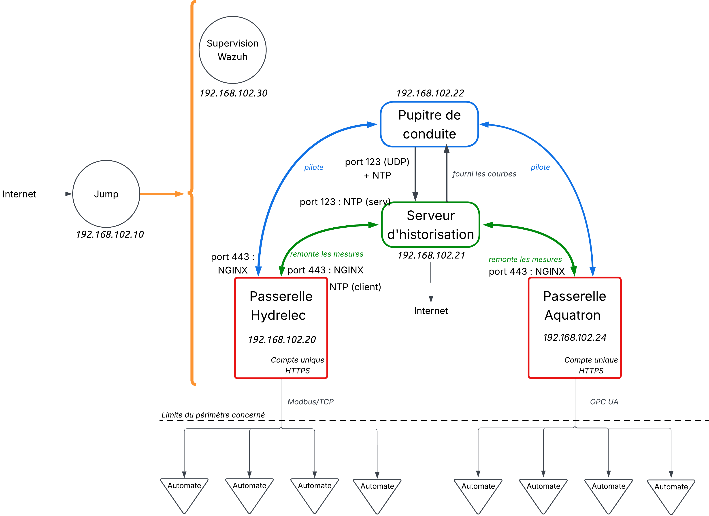
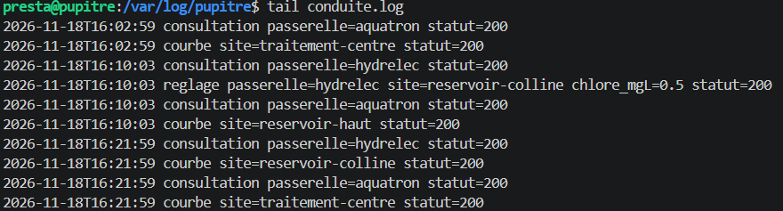
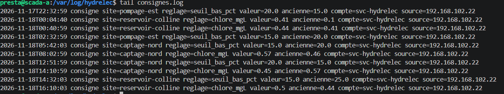
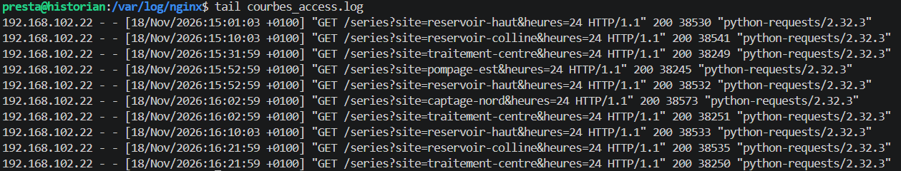

# Rapport final — [Nom du groupe] — Secteur [hôpital / eau / labo IA]

> **Gabarit imposé, noté sur 12.** Respectez les sections et les limites. Un rapport long et générique ne rapporte rien.
> Appuyez chaque affirmation sur des **artefacts à vous** : captures horodatées,
> extraits de logs avec vos IP et vos hostnames, extraits de config.
>
> Chaque section indique la séance qui la nourrit (voir
> [`deroule-seances.md`](deroule-seances.md)).

**Membres du groupe :** Maxime VANNIER - Vu Trung HOANG

**Date de rendu :** 29/11/2026

---

## 1. Architecture *(≤ 1 page)* · séances 1 et 2

*Le schéma de l'architecture **prévue**, à la seule lecture du dossier client découvert en séance 1.*


*Le schéma de l'architecture **réelle**, telle que vous l'avez découverte en
séance 2.*




| Écart constaté | Explication | Décision (autoriser / refuser / surveiller) |
|---|---|---|
|Machines manquantes (Jump et Wazuh)| non-évoqués dans le dossier client | rajoutées dans la matrice de flux, à surveiller |
|Flux NTP pour horloges synchronisés | non-évoqués dans les logiques métiers du client | autorisés |
|Flux de *historian* vers Internet | visible seulement depuis la machine concernée, utilisé pour mettre à jour son horloge en tant que master | à surveiller/refuser si solution autre |
|Flux métiers bidirectionnels| ambiguité dans le dossier client | autorisés |

## 2. Matrice de flux et durcissement *(≤ 1 page)* · séances 2 et 3

| # | Source | Destination | Port / proto | Justification | Preuve |
|---|---|---|---|---|---|
| 1 | Internet | jump | TCP/22 (exposé en 2202) | Point d'entrée unique d'administration | `ss`, incident SSH 06/11 |
| 2 | jump | scada-a, scada-b, historian, pupitre, wazuh | TCP/22 | Administration SSH | `ss -tnp` |
| 3 | jump, scada-a, scada-b, historian, pupitre | wazuh | TCP/1514 | Remontée des journaux (agents) | `ss -tnp` sur wazuh |
| 4 | jump, scada-a, scada-b, historian, pupitre | wazuh | TCP/1515 | Enrôlement des agents. Ouvert en permanence, limité aux 5 IP des agents | `ss -tulpn` wazuh |
| 5 | Internet (toutes les sources) | wazuh | TCP/443 | Dashboard Wazuh (exposé en 4402), protégé par authentification | `ss -tulpn` wazuh, journaux `IN-DROP` (`DPT=443`) |
| 6 | jump, scada-a, scada-b, pupitre, wazuh | historian | UDP/123 | Synchronisation horaire (historian = référence) | `chronyc clients`, `tcpdump` |
| 7 | historian | Internet (toutes adresses, **temporaire**) | UDP/123 | Obtention de l'heure de référence (aucune source interne). | `chronyc sources -n`, `tcpdump -i any -nn udp port 123` |
| 7 bis | historian | 9.9.9.9 (Quad9), 1.1.1.1 (Cloudflare) | UDP/53 (repli TCP/53) | **Temporaire** : résolution des noms des serveurs NTP. À supprimer quand les sources seront déclarées par IP | `resolvectl status`, `tcpdump -i any -nn port 53` |
| 8 | pupitre | historian | TCP/443 | Courbes (`GET /series`) | `courbes_access.log` |
| 9 | historian | scada-a, scada-b | TCP/443 | Collecte (`GET /registers`, toutes les 5 min) | `collecte.log` |
| 10 | pupitre | scada-a, scada-b | TCP/443 | `GET /registers`, consignes (`POST /setpoints`) | `passerelle_access.log`, `consignes.log` |

*Note sur le flux n°7: configuration temporaire puisqu'il serait judicieux de trouver une solution de mise à jour d'horloge sans passer par internet (par exemple par GPS) mais ce n'est pas possible dans le cadre de ce travail, avec les accès que nous avions. Nous avons donc laissé l'accès aux serveurs distants avec une résolution DNS car les IP de ces derniers varient.*

**Durcissement**:

Nous avons éditer le fichier /etc/iptables/rules.v4 afin d'appliquer nos politiques de blocages et avons rédigé chaque règles en fonction de la matrice ci-dessus avec une politique par défaut de DROP. Ci-dessous, un exemple des règles pour la machine *historian*:
```
# Règles iptables (IPv4) de cette historian, rechargées au démarrage par netfilter-persistent.

*filter
:INPUT DROP [0:0]
:FORWARD DROP [0:0]
:OUTPUT DROP [0:0]

# --- Base : loopback, paquets invalides, connexions etablies ---
# On accepte les flux provenant de connexions établies, en INPUT et OUTPUT puisque le filtrage
# d'établissement de ces connexions se fait dans les règles suivantes (construite à partir de la matrice de flux)

-A INPUT -i lo -j ACCEPT
-A OUTPUT -o lo -j ACCEPT
-A INPUT -m conntrack --ctstate INVALID -j DROP
-A OUTPUT -m conntrack --ctstate INVALID -j DROP
-A INPUT -m conntrack --ctstate ESTABLISHED,RELATED -j ACCEPT
-A OUTPUT -m conntrack --ctstate ESTABLISHED,RELATED -j ACCEPT

# Flux 2 : administration depuis jump
-A INPUT -p tcp -s 192.168.102.10 --dport 22 -j ACCEPT

# Flux 8 : courbes depuis pupitre
-A INPUT -p tcp -s 192.168.102.22 --dport 443 -j ACCEPT

# Flux 6 : serveur horaire pour jump, scada-a, scada-b, pupitre, wazuh
-A INPUT -p udp -s 192.168.102.10,192.168.102.20,192.168.102.22,192.168.102.24,192.168.102.30 --dport 123 -j ACCEPT

# Flux 9 : collecte vers scada-a et scada-b
-A OUTPUT -p tcp -d 192.168.102.20,192.168.102.24 --dport 443 -j ACCEPT

# Flux 3 et 4 : journaux et enrolement vers wazuh
-A OUTPUT -p tcp -d 192.168.102.30 --dport 1514 -j ACCEPT
-A OUTPUT -p tcp -d 192.168.102.30 --dport 1515 -j ACCEPT

# Flux 7 : NTP vers Internet (TEMPORAIRE : a restreindre aux IP des serveurs NTP)
-A OUTPUT -p udp --dport 123 -m comment --comment "TEMP flux7 NTP Internet" -j ACCEPT

# Flux 7 bis : DNS vers 9.9.9.9 et 1.1.1.1 (TEMPORAIRE : a supprimer apres passage des sources en IP)
-A OUTPUT -p udp -d 9.9.9.9,1.1.1.1 --dport 53 -m comment --comment "TEMP flux7bis DNS" -j ACCEPT
-A OUTPUT -p tcp -d 9.9.9.9,1.1.1.1 --dport 53 -m comment --comment "TEMP flux7bis DNS" -j ACCEPT

# --- Journalisation des refus (avant la politique DROP) ---
-A INPUT -m limit --limit 5/min --limit-burst 10 -j LOG --log-prefix "IN-DROP: "
-A OUTPUT -m limit --limit 5/min --limit-burst 10 -j LOG --log-prefix "OUT-DROP: "
COMMIT
```

Pour tester l'appplication de ces tables, la priorité était de vérifier que nous avions conservé nos accès SSH aux différentes machines. Ce fut bien le cas, mais nous nous sommes rendus compte après coup que, une fois chez nous, nous ne pouvions plus joindre le dashboard Wazuh. Cela provenait d'une erreur de configuration des iptables de la machine 'wazuh' (cf. Flux n°5) dont nous avions autorisé l'accès depuis internet UNIQUEMENT depuis une IP fixe, qui était celle d'un PC connecté à eduroam (wifi de l'école). Nous avons donc retiré ce filtre précis, et autoriser les connexions distantes uniquement dirigées vers le port 443 où était exposé le dashboard Wazuh. A noter que cela pose un problème de sécurité mineure puisque cette page reste protégée par un identifiant/mot de passe.

Enfin, nous avons regarder les différents logs métiers et logs réseaux (Nginx) des différentes machines pour s'assurer que les seuls flux restant étaient bien respectueux du cahier des charges du client, ce qui fut le cas. Voir les captures d'écran ci-dessous montrant la continuité des flux nécessaires post-iptables:

#### Connexion depuis scada-a vers les automates


#### Connexion pupitre vers passerelle (consultation et réglage)



#### Réceptions des consignes pupitre par sacada-a



#### Collecte des courbes depuis passerelle vers 'historian'


#### Requete d'historian vers passerelles




## 3. Supervision et détection *(≤ 1 page)* · séances 2 et 3

# TRUNG

*Les sources de journaux collectées dans votre SIEM (séance 2) : quelles
machines, quels journaux, pour voir quoi.*

| Source (machine) | Journal collecté | Ce qu'il permet de voir |
|---|---|---|
| … | … | … |

*Ce qui est **normal** chez votre client, puis vos règles de détection (séance
3) : pour chacune, source, logique et preuve de déclenchement (capture
horodatée). Indiquez aussi les ajustements de collecte faits en cours de
route.*

**Règle 1 — …** *Source · logique · preuve.*  **Règle 2 — …**  **Règle 3 — …**

## 4. Post-mortems d'incident *(≤ 2 page)* · séances 2 à 4

#### Incident 1: Tentative de Brute-Force SSH

L'incident 1, dont le post-mortem est rédigé dans ce [document](./post-mortem_attaque_SSH.pdf), a eu lieu le 6 novembre entre 20h01 et 20h03. Nous avons pu observer sur Wazuh un certain nombre de tentatives de connexions inhabituelles en très peu de temps: 16 tentatives détectées avec mauvais mot de passe sur l'user *'presta'* de la machine *'jump'* et 65 supplémentaires non-loguées après blocage automatique de l'IP source 175.110.115.54 (comportement automatique du démon d'OpenSSH). Aucune tentative n'a aboutit.

Nous avons pu investiguer cet incident à partir des alertes Wazuh et par la récupération des logs journalctl. Les commandes suivantes ont été utilisées:
```
#récupération des logs de l’attaque pour analyse approfondie
sudo journalctl -u ssh --since "2026-11-06 20:00" --until "2026-11-06 20:03" > ~/ssh_incident_1.log

#évacuation des logs de la machine jump :
scp -P 2202 presta@162.19.28.80:~/ssh_incident_1.log .

#IP sources
grep "Failed password" ./ssh_incident_1.log | awk '{print $ (NF-3)}' | sort | uniq -c | sort -nr | head

#Comptes ciblés
grep -oP 'for (invalid user )?\K\S+' ./ssh_incident_1.log | sort | uniq -c | sort -nr | head
```
Ces logs nous ont permis d'identifier des facteurs d'exposition de la machine comme le ssh exposé sur internet, le port 22 par défaut et le manque de restriction d'accès par IP ou VPN. Aussi, cet incident est survenu avant la mise en place d'alerte Wazuh automatique, ce qui participe au retard de détection.

Plus de détails sont accessibles dans le post-mortem ([post-mortem_attaque_SSH.pdf](./post-mortem_attaque_SSH.pdf))  


#### Incident 2:

# TRUNG

## 5. Prise de recul métier *(≤ 2 pages, ouverture)*

*La partie la plus valorisée du rapport. Avec le recul : quelles contraintes
du client vous ont gênés ? Quels sont les défauts de son infrastructure ?
Qu'est-ce que votre dispositif ne verrait pas ? Puis vos **suggestions
concrètes d'amélioration** : quoi changer, où, et ce que cela apporterait au
client (vous pouvez suggérer une nouvelle architecture). Ce n'est pas un exposé
de normes : c'est votre lecture de ce qui compte pour ce client précis.*


Au regard de l'activité de l'entreprise concernée et du dossier client qui nous a été fourni, les enjeux majeurs de sécurité à respecter qui ont été identifiés sont:
  - la continuité de service;
  - l'intégrité des données remontées jusqu'à l'opérateur;
  - l'intégrité des consignes envoyés vers les machines métiers;
  - l'isolation d'Internet quasi-complète de toute l'infrastructure du système;
  - la garantie d'accès aux machines, avec des comptes clairement définis;
  - une bonne capacité de supervision et de réponse à un incident à l'échelle de toute l'infrastructure.

Toujours côté client, plusieurs de ses contraintes ont pu nous géner dans notre travail comme par exemple la périmètre d'acion qui nous a été donné. En effet, nous n'avons pas pu isoler complètement le système d'Internet de par l'accès SSH nécessaire et l'utilisation du protocole NTP et du besoin pour le serveur maître (*historian*) d'actualiser son horloge depuis des serveurs distants. Un relai NTP interne ou une antenne GPS aurait pu être ajoutés. Aussi, la passerelle et les automates hors-périmètres étaient hors d'atteinte et nous avons dû autoriser ces flux dans la matrice sans pour autant pouvoir les observer en détail. Enfin, nous n'avions pas non plus la maîtrise des règles du NAT qui exposait différents services important de supervision et de connexion à l'infrastructure, mais nous avons considérer que dans un cas "réel" l'utilisation d'un NAT aurait été différente que pour un exercice pédagogique.

Le système quant à lui présente aussi des défauts structurels que l'on pourrait résumer comme ci-dessous:
  - **Une seule porte d'entrée, protégée par un mot de passe.** Le bastion *jump* est joignable depuis Internet avec une authentification par mot de passe. L'incident du 06/11 l'a illustré : 16 tentatives en environ une minute sur le compte presta, celui que nous utilisons nous-mêmes pour administrer, puis d'autres connexions rejetées par la pénalité automatique d'OpenSSH. Aucune connexion n'a abouti, mais ce blocage est temporaire et en mémoire. Nous ne pouvons pas dire si ce nom de compte a été deviné ou visé. Le dashboard Wazuh est lui aussi joignable depuis Internet, protégé par son seul mot de passe.
  - **Un réseau plat.** Toutes les machines sont dans le même sous-réseau en /24 : la séparation repose uniquement sur les pare-feux de chaque hôte, qu'un hôte compromis peut modifier lui-même.
  - **Horloge qui dépend d'un seul point et d'un protocole non authentifié.** Un serveur NTP compromis ou usurpé fausserait l'horodatage des consignes et la corrélation des journaux dans tout le réseau, ce qui poserai de graves problèmes au vu de la sensibilité du domaine de travail de la Régie des Eaux.
  - **Des échanges métiers peu contrôlés**. Comptes partagés, et verify=False dans collecte.py : les certificats des passerelles ne sont pas vérifiés, ce qui permettrait d'en usurper une. On imagine que dans la réalité, les logiques métiers sont bien plus sécurisées.
  - **Des points uniques de défaillance:** jump (seule voie d'administration), wazuh (seule supervision) et historian (heure et collecte). De plus, les accès à ces machines (du moins pour @presta) sont des accès root.

De plus, notre dispositif ne permet pas la compréhension intégrale des différents mécanismes du système. Comme évoqué précédemment, le contenu des échanges avec les automates n'est pas accessible et ne nous permet pas d'installer des agents Wazuh sur les machines concernés. Des commandes Modbus ou OPC UA bien formées mais malveillantes ne seraient détectées. Par ailleurs, nos règles Wazuh définissent seulement des plages autorisés de valeur pour les consignes (ex. la concentration de chlore). Cela ne permet pas d'esquiver l'injection de consignes faussées subtilement (pas de vérification précise, seulement des valeurs en clair). Aussi, un flux de consigne qui s'interrompt ou un agent Wazuh silencieusement coupé ne serait pas automatiquement détecté. De plus, nous n'avons pas eu accès aux différents comptes donc nos corrections n'ont pas permis de segmenter les accès et délimiter les droits des différents utilisateurs (nous n'avions accès qu'au compte @presta). Enfn, Wazuh n'a pas de canal de sortie configuré pour un alerting plus rapide et l'isolation d'Internet rend plus diffiile les correctifs et mises à jour logicielles.

Enfin, nous proposons ces pistes d'amelioration:

| # | Suggestion | Où | Ce que cela apporte au client | Priorité |
|---|---|---|---|---|
| 1 | Authentification SSH par clés uniquement, `AllowUsers`, accès par VPN ou liste d'IP plutôt qu'un port ouvert sur Internet. Même traitement pour le dashboard (VPN ou tunnel SSH) | jump, passerelle, wazuh | Une attaque comme celle du 06/11 devient sans effet, quelle que soit la force du mot de passe | Haute, immédiate |
| 2 | Mot de passe d'enrôlement Wazuh, et fermeture de 1515 hors enrôlement | wazuh | Une machine compromise ne peut plus s'inscrire comme faux agent | Haute |
| 3 | Canal d'alerte sortant (relais SMTP ou webhook interne) et blocage automatique des sources hostiles | wazuh, passerelle | Les alertes graves, comme une consigne depuis une source inattendue, atteignent une personne sans attendre qu'elle regarde l'écran | Haute |
| 4 | Source de temps interne : serveur NTP sur la passerelle ou un équipement dédié, éventuellement avec GPS | passerelle, zone d'administration | Supprime le seul flux Internet d'historian et fiabilise l'horodatage des consignes | Moyenne |
| 5 | Un compte par flux (historian et pupitre distincts), certificats d'une CA interne, vérification activée dans `collecte.py` | passerelles, collecte | On sait quelle machine a envoyé une consigne, et une passerelle ne peut plus être usurpée | Moyenne |
| 6 | Sonde réseau (Suricata ou Zeek) sur un port miroir côté process, avec analyse Modbus et OPC UA | zone process | Rend visibles les commandes envoyées aux automates, là où aucun agent ne peut être installé | Moyenne |
| 7 | Contrôle de plausibilité et chiffrement des consignes sur les passerelles | scada-a, scada-b | Une consigne aberrante est refusée, qu'elle vienne d'une erreur d'opérateur ou d'une attaque | Moyenne |
| 8 | Dépôt de mises à jour interne, fenêtre de maintenance et sauvegarde de la configuration Wazuh (règles, décodeurs, groupes) | tout le réseau | Des machines à jour et une supervision reconstructible en cas de panne | Moyenne |
| 9 | Segmentation réseau en trois zones derrière un pare-feu | réseau | Un hôte compromis ne peut plus atteindre directement la zone process | À moyen ou long terme |

Tout cela devrai s'articuler autour d'une nouvelle architecture avec plusieurs zones séparés par des pare-feux et éventuellement différents VLANs et sous-réseaux pour isoler des mécanismes à l'intérieur même du système global:
- une **zone d'administration** (jump derrière VPN, wazuh, serveur NTP interne) ;
- une **zone de données** (historian, pupitre) ;
- une **zone process** (scada-a, scada-b, automates), avec une sonde réseau sur un port miroir.

## 6. Journal de bord *(≤ 1 page)* · toutes les séances

- **Répartition** : 

  - *Maxime*: 
    - Analyse préliminaire de l'architecture client;
    - Identification des flux réseaux et métiers et description des écarts constatés; 
    - Affinage de la matrice de flux, notamment pour la partie NTP;
    - Rédaction, application, test et correction des iptables;
    - Analyse et rédaction post-mortem de l'incident n°1;
    - Rédaction de ces parties et de la prise de recul métier dans le rapport-final.

  - *Trung*: 

 
- **Usage de l'IA** :

  - *Maxime*: Utilisation de Claude et Gemini
  
      * la compréhension de certains mécanismes et protocoles, notamment NTP.
      * aide pour la liste des commandes à utiliser pour l'extraction et l'analyse de logs
      * aide pour la syntaxe des iptables
      * la mise en forme de tableaux à partir d'un prompt détailé du contenu souhaité (matrice de flux et piste d'amélioration) et corrections

  - *Trung*: 

---

## Annexes *(libres, non notées)*

*Configurations complètes, extraits de logs bruts, captures supplémentaires.*
