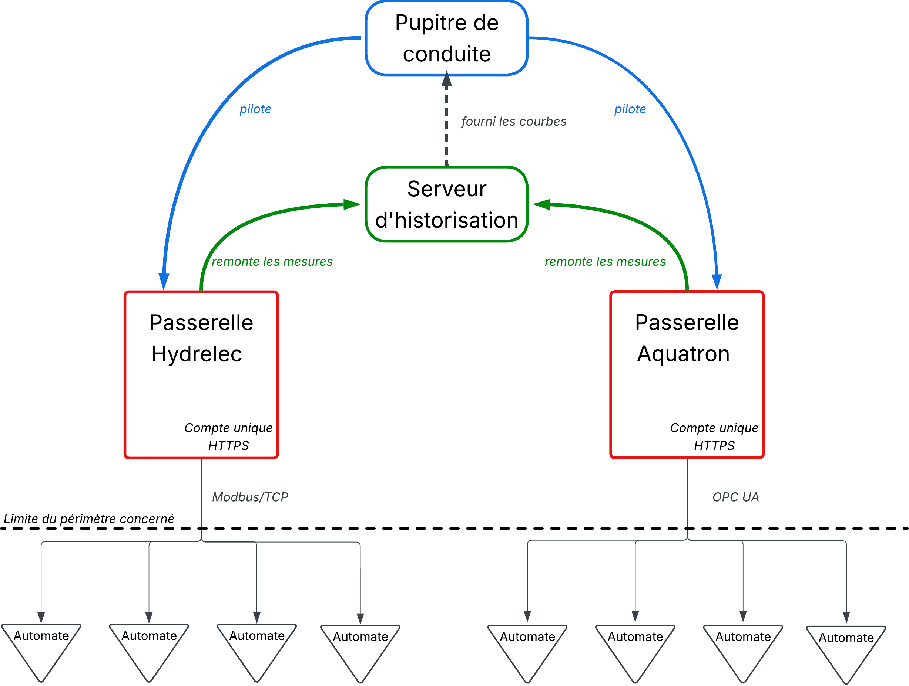

# Rapport final — [Nom du groupe] — Secteur [hôpital / eau / labo IA]

> **Gabarit imposé, noté sur 12.** Respectez les sections et les limites. Un rapport long et générique ne rapporte rien.
> Appuyez chaque affirmation sur des **artefacts à vous** : captures horodatées,
> extraits de logs avec vos IP et vos hostnames, extraits de config.
>
> Chaque section indique la séance qui la nourrit (voir
> [`deroule-seances.md`](deroule-seances.md)).

**Membres du groupe :** …
**Date de rendu :** …

---

## 1. Architecture *(≤ 1 page)* · séances 1 et 2

*Le schéma d'architecture **attendu**, produit en séance 1 à partir du seul
dossier client, inséré **tel quel** : ne le corrigez pas.*

<<<<<<< HEAD
*[insérer le schéma attendu de la séance 1]*
=======

>>>>>>> d3dccda (ajout schéma infra Séance 1)

*Le schéma de l'architecture **réelle**, telle que vous l'avez découverte en
séance 2.*

*[insérer le schéma réel]*

*Les écarts entre les deux (si constatés), et pour chacun **pourquoi** il existe (flux oublié,
flux technique, flux que le client ignorait, flux inexpliqué…).*

| Écart constaté | Explication | Décision (autoriser / refuser / surveiller) |
|---|---|---|
| … | … | … |

## 2. Matrice de flux et durcissement *(≤ 1 page)* · séances 2 et 3

*Votre matrice de flux, proposée en séance 2 : qui a le droit de parler à quoi,
et pourquoi. Elle doit correspondre aux iptables de chaque machine (séance 3).*

| Source | Destination | Port / protocole | Justification |
|---|---|---|---|
| … | … | … | … |

*Durcissement (séance 3) : comment vous avez traduit la matrice en iptables, et
comment vous avez vérifié, grâce à vos journaux, que le client fonctionnait
toujours.*

## 3. Supervision et détection *(≤ 1 page)* · séances 2 et 3

*Les sources de journaux collectées dans votre SIEM (séance 2) : quelles
machines, quels journaux, pour voir quoi.*

| Source (machine) | Journal collecté | Ce qu'il permet de voir |
|---|---|---|
| … | … | … |

*Ce qui est **normal** chez votre client, puis vos règles de détection (séance
3) : pour chacune, source, logique et preuve de déclenchement (capture
horodatée). Indiquez aussi les ajustements de collecte faits en cours de
route.*

**Règle 1 — …** *Source · logique · preuve.*  **Règle 2 — …**  **Règle 3 — …**

## 4. Post-mortems d'incident *(≤ 2 page)* · séances 2 à 4

*Un post-mortem par incident que vous avez subi. À vous de juger ce qui mérite
d'y figurer pour qu'il soit utile. Pensez à ce dont aurait besoin quelqu'un qui
n'était pas là : ce qui s'est passé et quand, comment vous l'avez vu (ou pas),
ce que vous en concluez et ce que vous changez ensuite. Si un incident vous a
échappé, dites-le et expliquez comment vous compteriez le voir la prochaine
fois. Appuyez-vous sur vos artefacts (logs, captures).*

**Incident — [séance, date] — …** *(un bloc par incident)*

## 5. Prise de recul métier *(≤ 1 page, ouverture)*

*La partie « ouverture », à travailler surtout en vue de la soutenance. Avec le
recul : quelles contraintes du client vous ont gênés ? Qu'est-ce que votre
dispositif ne verrait pas ? Que recommanderiez-vous au client ? Ce n'est pas un
exposé de normes : c'est votre lecture de ce qui compte pour ce client précis (vous pouvez suggérer une nouvelle architecture).*

## 6. Journal de bord *(≤ 1 page)* · toutes les séances

- **Répartition** : *qui a fait quoi.*
- **Usage de l'IA** : *où elle vous a aidés, et ce que vous avez vérifié
  derrière. Fun fact lié à l'usage de l'IA durant le projet*

---

## Annexes *(libres, non notées)*

*Configurations complètes, extraits de logs bruts, captures supplémentaires.*
